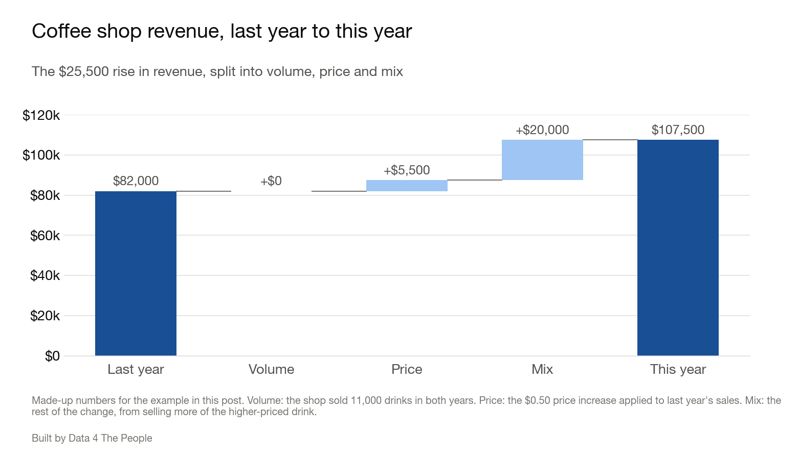

# Price or Mix? How Rising Education Changes the Story on Pay

On October 29, after a delay of about six weeks, the Census Bureau finally released the results of its 1-year American Community Survey (ACS) for 2025. Over the weekend, we rolled up our sleeves and dug in, excited to see what new learnings we could find on America’s larger communities (the 1-year ACS covers only areas with 65,000 or more people).

We started with a topic we haven’t yet explored – educational attainment. We created a visualization to see how educational attainment changed between 2015 and 2025 – by state, county, and metro/micro area. See how your area did below.

<iframe src="https://data4thepeople.github.io/educational-attainment/dist/?v=20261101a#embed=1" width="100%" height="900" loading="lazy" style="border:0" title="Educational attainment and pay: interactive map by state, county and metro or micro area, 2015 to 2025"></iframe>
::: spacer 20px

## Education is rising in most places

On its own, the educational attainment data is quite encouraging. The share of America with more education is not only rising on the aggregate but is rising just about everywhere. The next chart shows how much education rose in each metro and micro area over the past decade, and the percentage of areas where the rise was statistically significant.

*Each dot is one of 391 metro and micro areas. Dark blue dots had a rise large enough to pass the Census Bureau's test at 90% confidence.*

So that’s fantastic. Story over?

Not so fast. This got me thinking about how people (including myself) analyze pay data. I’ve spent a lot of time poking around in pay data at the county level and have compared one period to another often in the past.

But if educational attainment is changing so dramatically, is it appropriate to draw any conclusions from the changes without adjusting them for variables like educational attainment? Probably not. To explain why, we need to talk about a concept the corporate finance world calls “mix.”

## A mixed-up coffee shop

Let’s say you are hired to do revenue analysis for your friend’s coffee shop. Luckily, the shop only has two products – drip coffee and a triple-whip mocha pumpkin spiced matcha latte (TWMPSML for short).

Here’s the info you need to do the middle school math that corporate finance professionals specialize in (I used to be one of them so I can poke fun at the profession).

Last year, the shop sold 5,000 coffees at $2 each and 6,000 TWMPSMLs at $12 each. This year the shop sold 3,000 coffees at $2.50 each and 8,000 TWMPSMLs at $12.50 each.

Overall, the shop’s revenue went from $82,000 to $107,500, an increase of $25,500 or 31%.

What’s the revenue impact from volume? That’s easy. It’s zero since in both years the shop sold 11,000 drinks.

Now what about price? To calculate that, you must apply only the change in pricing to the base year’s volume. Both coffee and TWMPSML took a $0.50 price increase. Applying that to last year’s volume tells us that pricing alone explains just $5,500 of the revenue increase.

So, what explains the remaining $20,000 increase? That is all MIX. The shop sold far more of the expensive items and fewer of the cheaper items. The chart below shows all three pieces.

*Made-up numbers for the coffee shop example.*

Notice this provides the shop with different insight than just telling your friend, “Your revenue rose 31%” and letting them guess the reason why. This pinpoints that her success was due to the popularity of the TWMPSML.

## Pay and the education mix

I offer this illustration to help understand the problem with pay analysis over time when there are major underlying demographic (i.e., mix) changes in a community. Increased pay in a community could be driven by better educational attainment (i.e., more college grads) rather than companies increasing pay within a fixed level of educational attainment.

And so, I added this to the visualization. Just switch the topic from Education to Pay and you can see how much of the increase in pay comes from higher pay within each education group and how much comes from the change in education mix. The following chart shows the summary of this pay and mix analysis for the nation.

*Pay is median earnings of people 25 and over who had earnings, in 2025 dollars. Yearly change is the average yearly growth rate over the 10 years, with compounding. The pay index weights each group's median pay by that group's share of all adults 25 and over.*

From 2015 to 2025, the pay index rose 1.00% a year after inflation. The index weights each group's median pay by that group's share of adults 25 and over. Pay within most education groups rose more slowly. Median pay rose 0.33% a year for workers with a bachelor's degree and was flat for workers with a graduate or professional degree (down 0.02% a year, a change too small to pass the Census Bureau's test). Only workers without a high school diploma saw their median pay rise faster than the index, at 1.78% a year.

Over the same years, the education mix shifted. The share of adults 25 and over with a bachelor's degree or more rose from 30.6% to 37.4%. The share without a high school diploma fell from 12.9% to 9.4%. More adults are now in the groups with higher pay. In finance terms, that is a more favorable mix.

The pay index in the map splits this change into two parts. With the education mix held at 2015 shares, the index would have risen 0.49% a year. The other 0.51 points a year are pay index growth from the change in education mix. In other words, about half of the rise in the pay index lines up with higher pay within education groups, and about half lines up with Americans having more education.

## Pay and the mix, area by area

Nationally, growth in the pay index split about evenly between the two parts. That even split does not carry over to each metro and micro area. The next chart shows the split for the 129 areas where both parts pass the test, out of 391 with comparable boundaries.

*Each dot is one metro or micro area; the three examples below are circled. The two parts add up to the yearly change in the pay index. Dots above the dashed line have a larger education mix part than pay part. The test for the education mix part is approximate.*

Look at how widely the dots are scattered. Yet again we see that analyzing America from the top down tells us little about America's communities. Three examples show the range.

- **New York:** The pay index rose 0.46% a year. Pay within education groups fell 0.20% a year, so all of the growth came from the change in education mix (0.65 points a year).
- **Indianapolis:** The pay index rose 1.05% a year, split about evenly: 0.53% a year from pay within education groups and 0.52 points a year from the education mix.
- **Twin Falls, ID:** The pay index rose 3.24% a year. Almost all of it, 3.06% a year, came from pay within education groups. The education mix added 0.18 points a year.

## The bottom line

Here are a few takeaways.

First, don’t walk away from this analysis thinking that the less than high school crowd is the big winner over the past decade because they led the pack in pay increases. In 2025, Americans without a high school diploma had median earnings of just $34,670. Start adding up your expenses and it won't take you long to surpass that income. For many households, it’s just not enough to make ends meet, so there is no celebrating their 1.78% annualized pay increases. Plus, this could just be supply and demand… the share of adults 25 and over without a high school diploma dropped from 12.9% to 9.4% over the past decade, lowering the supply of people that can work the jobs serving people with higher education. Lower supply could drive higher pay.

But then I find it fascinating that people with more education mostly saw smaller pay increases over the past decade. If you had a graduate degree, median pay just kept pace with inflation and that’s it. And that’s just the national story. Use the tool and start exploring each metro area or county. [tell the reader how to do this and show a screenshot of the tooltip that shows the breakdown ofpay and mix]. It’s fascinating to see how different pay increases are at different levels of educational attainment in different parts of the country.

What blows my mind even more is the realization that educational attainment is just one of hundreds of variables that are part of mix. Demographics are changing across America, which is complicating pay analysis. Can we precisely isolate the pay component from the myriad demographic mix variables? No, we can’t. But at the very least, today’s analysis shows that Americans are working hard to better themselves by getting more education, and nationally that shift lines up with about half of the growth in our inflation-adjusted pay index over the past decade.

So the next time you see a headline that pay is up, ask the coffee shop question: was it price, or was it mix?

::: divider

## How we did this

- **Data.** Education comes from the Census Bureau's American Community Survey 1-year estimates, table B15003, for adults 25 and over. Pay comes from table B20004, median earnings of people 25 and over who had earnings. We compare 2015 with 2025.
- **Inflation.** We moved 2015 dollars to 2025 dollars with the Bureau of Labor Statistics R-CPI-U-RS price index. Prices rose 36.3% over the period.
- **Tests.** A change counts as statistically significant when it passes the Census Bureau's test at 90% confidence. For the education mix part of the pay index, and for the pay index total, we built approximate tests from parts of the Census Bureau's formulas, because the Census Bureau has no published formula for these measures.
- **Pay index.** The index weights each education group's median pay by that group's share of all adults 25 and over. It is an index, not a median. Its weights cover all adults, including people who do not work, while the medians cover only people with earnings.
- **Comparable areas.** The 1-year survey covers only areas with 65,000 or more people. We compared only areas published in every year from 2015 to 2025, and left out metro and micro areas where a change in their counties after 2015 moved their adult population by 5% or more in a single year.

**What this does not tell you**

- The pay medians include part-time and part-year workers, so changes in hours worked are part of these pay changes.
- Education is only one part of mix. Age, industry and hours also shift over time, and the pay index does not separate them.
- In 2025 the Census Bureau changed the education question and collected less data during the federal funding lapse. Part of the rise in "high school or more" and "some college or more" may come from these survey changes.
- Each change compares only two years, 2015 and 2025.
